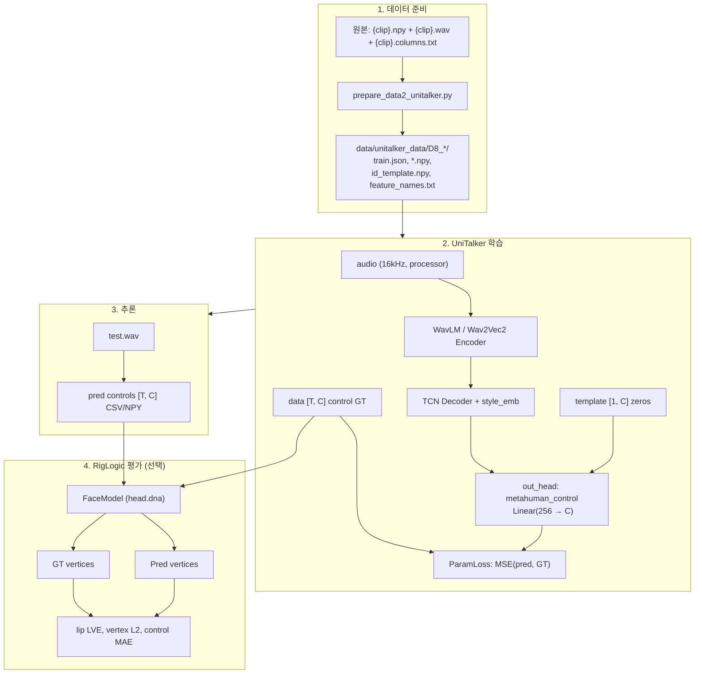

# MetaHuman Rig Logic + Control 값을 UniTalker에 통합하는 방법

이 문서는 **MetaHuman rig control 시계열(GT)** 과 **RigLogic forward model(Head Decoder)** 을 활용해, UniTalker가 오디오에서 MetaHuman 얼굴을 직접 구동하도록 연결하는 전체 경로를 정리합니다.

> **전략 (구현 전 합의)**: [METAHUMAN_RIGLOGIC_TRAINING_STRATEGY.md](./METAHUMAN_RIGLOGIC_TRAINING_STRATEGY.md) — RigLogic을 **학습 코드 안**에 넣기 위한 주장·로드맵. 본 문서는 현재 연동·실행 방법 위주.

관련 코드:
- **전략 문서**: [METAHUMAN_RIGLOGIC_TRAINING_STRATEGY.md](./METAHUMAN_RIGLOGIC_TRAINING_STRATEGY.md)
- UniTalker 학습 (메인): `models/unitalker/`
- RigLogic 패키지: `third_party/riglogic/`
- RigLogic 평가: `models/unitalker/riglogic_eval/`
- annot 스케일 점검: `util/audit_annot_scales.py`
- 데이터 변환: `util/prepare_data2_unitalker.py`
- 이전 가이드(뷰어 분리 관점): `MIGRATE_docs/RIGLOGIC_UNITALKER_HEAD_DECODER_MIGRATION.md`

---

## 1. 한 줄 요약

```
[MetaHuman GT: clip.npy + clip.columns.txt]
        ↓  (데이터 변환)
[UniTalker 학습: annot_type=metahuman_control, MSE on controls]
        ↓  (추론)
[pred controls: CSV/NPY]
        ↓  (RigLogic FaceModel — deterministic Head Decoder)
[MetaHuman vertices] → lip LVE / vertex L2 평가 또는 실시간 렌더
```

UniTalker는 **control 값 자체를 예측**하고, RigLogic은 **control → 3D mesh** 를 담당합니다.  
ARKit blendshape나 FLAME vertex 경로와 달리, **PCA·blendshape basis·vertices loss를 쓰지 않습니다.**

---

## 2. 왜 이 방식인가

### 2.1 기존 UniTalker(D0–D7)와의 차이

| 항목 | D0–D7 (논문 기본) | D8 MetaHuman (본 프로젝트) |
|------|-------------------|----------------------------|
| GT 표현 | vertices / blendshape / FLAME params | **MetaHuman rig control 스칼라** |
| annot_type | `BIWI_23370_vertices`, `3DETF_blendshape_weight` 등 | **`metahuman_control`** |
| PCA | vertex dataset은 512-dim PCA 사용 | **사용 불가** (control은 이미 저차원) |
| Loss | VerticesLoss / BlendShapeLoss (vertices 환산 포함) | **ParamLoss = MSE(control)** |
| 사전학습 이전 | D0–D7 체크포인트 fine-tune 가능 | **불가** (출력 차원·loss 공간 불일치) |
| 최종 mesh | PCA decode 또는 blendshape basis | **RigLogic FaceModel** |

`dataset_config.py` 주석에도 명시되어 있듯, GT가 mesh가 아니라 **rig control 스칼라**이므로 UniTalker의 PCA encode→decode 경로를 쓸 수 없습니다.

### 2.2 RigLogic의 역할

RigLogic(`third_party/riglogic/face_model.py`)은 학습에 쓰이는 **미분 가능한 loss 레이어가 아니라**, 평가·배포 시의 **결정론적 Head Decoder**입니다.

```python
# 개념 API (face_model.py)
fm = FaceModel(dna_path, lod=0, meshes="head")
fm.set_columns_file("clip.columns.txt")
verts = fm.eval_columns_batch(controls)  # (F, C) → (F, V, 3)  단위: cm
```

- **입력**: MetaHuman expression control 벡터 (~260열, columns.txt 순서)
- **출력**: DNA bind pose 기준 world vertices (V=15729 for `meshes=face`)
- **매핑**: `CTRL_expressions_foo` (NPY 컬럼) → `CTRL_expressions.foo` (raw RigLogic)

---

## 3. 전체 아키텍처



**핵심 설계 선택**: 논문의 multi-head 구조는 그대로 두고, `annot_type=metahuman_control` 전용 head 하나를 추가·단독 학습합니다.

---

## 4. MetaHuman Control 데이터 정의

### 4.1 원본 파일 (DatasetGen / DATA2)

| 파일 | 형식 | 설명 |
|------|------|------|
| `{clip}.npy` | `[T, C]` float32 | 프레임별 MetaHuman expression control |
| `{clip}.columns.txt` | 줄당 1컬럼명 | NPY 열 순서와 1:1 대응 |
| `{clip}.wav` | mono 16kHz+ | 동기 오디오 |

- **C ≈ 260**: MetaHuman expression board 컬럼 수 (클립마다 동일 layout 권장)
- 컬럼명 예: `CTRL_expressions_jawOpen`, `CTRL_expressions_mouthSmileL`, ...
- **이름은 npy에 저장되지 않음** — 반드시 `.columns.txt` 또는 `feature_names.txt`로 관리

### 4.2 UniTalker 학습용 변환 후

`util/prepare_data2_unitalker.py`가 생성하는 구조:

```
data/unitalker_data/D8_metahuman_control/
├── train.json / val.json / test.json
├── id_template.npy          # shape [1, C], 전부 0 (neutral control)
├── feature_names.txt        # 선택된 C개 컬럼명 (순서 = npy 열 순서)
├── train/
│   ├── {stem}.npy         # [T, C]
│   └── {stem}.wav
├── val/
└── test/
```

`train.json` 항목 예:

```json
{
  "annot_type": "metahuman_control",
  "annot_path": "train/clip__c000.npy",
  "audio_path": "train/clip__c000.wav",
  "id": 0,
  "fps": 30,
  "dataset": "D8"
}
```

### 4.3 dataset_config 등록

`models/unitalker/dataset/dataset_config.py`:

| dataset 키 | annot_dim | annot_type | 비고 |
|------------|-----------|------------|------|
| `D8` | 260 | `metahuman_control` | 전체 expression |
| `D8_sanity` | 260 | `metahuman_control` | 1클립 overfit 검증 |

공통: `pca: False`, `scale: 1.0`, `subjects: 1`

---

## 5. 데이터 준비 (단계별)

### 5.1 전체 260채널 데이터셋

```bash
cd /home/motion/omotion/trainFramework

python util/prepare_data2_unitalker.py \
  --src-dir /path/to/metahuman/clips \
  --dataset-name D8 \
  --annot-type metahuman_control \
  --annot-dim 260 \
  --output-root data/unitalker_data \
  --split-ratio 8,1,1 \
  --chunk-seconds 15,15,10
```

- `--annot-dim -1`: 첫 npy에서 자동 감지
- `--chunk-seconds none`: 분할 없이 클립 단위 유지
- 긴 클립은 15+15+10초 패턴으로 잘라 VRAM·수렴 안정성 확보

### 5.2 (삭제됨) Lipsync-only 200ch

200ch lipsync 전용 dataset(D9) 및 학습 run은 프로젝트에서 제거되었습니다. MetaHuman 학습은 **D8 260ch**만 사용합니다.

---

## 6. UniTalker 모델에 넣는 방식 (코드 레벨)

### 6.1 annot_type 라우팅

UniTalker는 `annot_type` 문자열로 head·loss를 선택합니다.

**모델 초기화** (`models/unitalker/model/unitalker.py`):

```python
for dataset_name in args.dataset:
    annot_type = dataset_config[dataset_name]["annot_type"]
    out_dim = dataset_config[dataset_name]["annot_dim"]  # 260
    out_head_dict[annot_type] = nn.Linear(decoder_dim, out_dim)  # headlayer=1
```

**forward**:

```python
out_motion = self.out_head_dict["metahuman_control"](decoder_out) + template
# out_motion: [B, T, C]
```

- `template`: `id_template.npy[0]` — 전부 0인 neutral control
- residual 학습: 모델은 deviation 예측, 출력 = delta + template (template=0이면 절대값과 동일)

### 6.2 Loss

`models/unitalker/loss/loss.py`:

```python
"metahuman_control": ParamLoss(bs_beta=0.0)
# forward: MSE(pred, gt)
```

학습 루프 (`train_eval_loop.py`):

```python
loss = rec_loss + args.pca_weight * pca_loss   # pca_weight=0.0 고정
```

| Loss 종류 | MetaHuman에서 사용 | 이유 |
|-----------|-------------------|------|
| MSE(control) | **사용 (학습)** | GT가 control이므로 직접 회귀 |
| PCA loss | 미사용 | control에 PCA 없음 |
| BlendShape→vertices | 미사용 | EmoTalk/ARKit basis와 무관 |
| RigLogic vertex loss | **미구현 (eval만)** | forward가 느리고 미분 파이프라인 별도 필요 |

### 6.3 사전학습을 쓰지 않는 이유

`configs/train_D8_metahuman_control.yaml`:

```yaml
weight_path: null   # D0-D7 체크포인트 이전 불가
```

- 기존 head: 52-dim blendshape, 70110-dim PCA 등 — **출력 차원 불일치**
- 기존 loss: vertices/blendshape 공간 — **loss 공간 불일치**
- encoder는 동일 아키텍처이나, MetaHuman 실험은 **scratch 또는 encoder-only warm-up**(`fix_encoder_first: True`)으로 시작

---

## 6.4 annot 스케일 점검 및 Head Pose MSE

MetaHuman control은 ARKit blendshape처럼 **strict 0~1이 아닙니다**. HeadYaw 등 head pose 채널은 degree급 값으로 plain MSE를 지배합니다.

```bash
python util/audit_annot_scales.py --datasets D8,D6,D3
# 리포트: docs/reports/annot_scale_audit.json
```

| 학습 variant | 채널 | head pose | 권장 |
|--------------|------|-----------|------|
| Full control (default) | 260 | loss mask (`metahuman_loss_exclude_head_pose: true`) | RigLogic full export |

- 제외 목록: `configs/metahuman_drop_head_pose.txt` (7ch)
- LVE: `lve_weight: 0.0` 고정 (vertex ID 확정 후 연동)

---

## 7. 학습 실행

공통 진입점:

```bash
cd /home/motion/omotion/trainFramework
bash scripts/train.sh configs/train_D8_metahuman_control_pretrained.yaml
```

### 7.1 전체 control (260ch) — **default**

```bash
bash scripts/train.sh configs/train_D8_metahuman_control_pretrained.yaml
```

`metahuman_riglogic_basis_path`: D8 260ch vertex rec loss. val metric: `rec_L2_loss`, `control_MSE`, `LVE`.

### 7.2 Scratch (260ch, optional)

```bash
bash scripts/train.sh configs/train_D8_metahuman_control_scratch.yaml
```

PRETRAINED fine-tune은 `UniTalker-B-D0-D7.pt`에서 encoder/decoder 로드, D8 head(260ch) random init.

### 7.3 D0–D7 + D8 혼합 학습

```bash
bash scripts/train.sh configs/train_D0-D7_D8_metahuman.yaml
```

### 7.4 Sanity (1 clip overfit)

```bash
bash scripts/train.sh configs/train_D8_1clip_sanity.yaml
```

---

## 8. 추론 (Inference)

### 8.1 오디오 → pred control

```bash
python models/unitalker/infer_audio_to_csv.py \
  --checkpoint models/unitalker/results_D8_metahuman_lipsync_only/XXX.pt \
  --audio test.wav \
  --dataset D8 \
  --output pred_clip.csv
```

출력:
- CSV: `frame`, `time_sec`, + `feature_names.txt` 컬럼 순서의 control 값
- 또는 NPY: `[T, C]`

### 8.2 추론 시 모델 입력

| 인자 | 값 |
|------|-----|
| `audio` | Wav2Vec2FeatureExtractor 정규화 waveform |
| `template` | `id_template.npy[0]` (zeros) |
| `face_motion` | `None` |
| `style_idx` | `0` (단일 subject) |
| `annot_type` | `"metahuman_control"` |
| `fps` | `30` |

---

## 9. RigLogic으로 품질 평가 (Head Decoder)

학습 loss는 control MSE이지만, **지각 품질·lip sync**는 vertex 공간에서 봐야 합니다.  
이때 RigLogic FaceModel이 Head Decoder 역할을 합니다.

### 9.1 사전 준비

1. **DNA** 배치 후 `configs/riglogic.yaml` 또는 환경변수 설정:

```bash
export RIGLOGIC_DNA=/path/to/DNA/0421_V33/head.dna
```

2. **RigLogic extension 빌드**:

```bash
cd third_party/riglogic
pip install -r requirements.txt
python setup.py build_ext --inplace
```

3. **lip mask** (MH-LVE-LIP-v1): `metahuman_head_lod0_lip_mask.csv` (`riglogic.yaml` → `lip_vertex_mask`)

### 9.2 단일 클립 비교

```bash
python models/unitalker/run_riglogic_eval.py \
  --gt  data/unitalker_data/D8_metahuman_control/val/clip.npy \
  --pred models/unitalker/results_.../pred_clip.csv \
  --columns /path/to/clip.columns.txt \
  --out riglogic_eval.json
```

또는 inference 결과 디렉터리:

```bash
python models/unitalker/run_riglogic_eval.py \
  --results-dir models/unitalker/results_D8_metahuman_lipsync_only/inference_same_sample \
  --out riglogic_eval.json
```

### 9.3 평가 지표

| 지표 | 공간 | 설명 |
|------|------|------|
| `control_mae` / `control_mse` | control | 프레임·컬럼별 MSE (학습 loss와 동일 공간) |
| `lip_lve_mean` | vertex | MH-LVR v1 lip mask, LVE 유사 지표 |
| `vertex_mean_l2` | vertex | 전체 정점 평균 L2 (cm) |
| `zero_control_deviation_cm` | sanity | 0 control → neutral mesh 편차 (~1e-5 cm 기대) |

### 9.4 Lipsync-only pred → full 260 layout

### 9.4 partial control → 260 layout (legacy API)

일부 레거시 checkpoint가 200ch partial layout을 쓸 경우, `riglogic_eval/controls.py`의 `expand_to_full_columns()`로 260 layout에 zero-fill 후 RigLogic forward 가능. **현재 학습/배포는 D8 260ch native만 사용.**

### 9.5 D8 260ch baseline 비교 (v5)

**등록된 baseline** (`configs/metahuman_baselines.json`):

| id | 트랙 | loss | 체크포인트 |
|----|------|------|-----------|
| `260ch_control_scratch` | S8 Standalone | rec + 0.0001·bs | `results_D8_control260_scratch/best.pt` |
| `260ch_control_pretrained` | P8 PRETRAINED | rec + 0.0001·bs | `results_D8_control260_pretrained/best.pt` |

```bash
python util/compare_metahuman_checkpoints.py --list-baselines

python util/compare_metahuman_checkpoints.py \
  --baseline-manifest configs/baseline_D8_metahuman_260ch_mse.json \
  --candidate-checkpoint models/unitalker/results_D8_control260_pretrained/best.pt \
  --split val
```

**val best (epoch 50 cap, rec+bs loss)**:

| run | best epoch | val rec_L2_loss | test rec_L2_loss (last) |
|-----|-----------|-----------------|-------------------------|
| S8 scratch | 4 | **0.00341789** | 0.00157840 |
| P8 PRETRAINED | 4 | **0.00339118** | 0.00160163 |

**서비스 default MetaHuman run**: `results_D9_nuridam_control_pretrained` (`run_config.csv is_default=true`, ckpt 존재).  
레거시 `results_D8_control260_pretrained`는 ckpt 없음 → `hasCheckpoint: false`. FaceTool 계약: [`FACETOOL_SERVICE_CONTRACT.md`](FACETOOL_SERVICE_CONTRACT.md).

**val 5-clip control MSE 비교** (S8 baseline vs P8): delta negligible (~+0.05% MSE). 상세: `docs/reports/metahuman_checkpoint_compare.json`

---

## 10. 세 가지 연동 시나리오 (참고)

`MIGRATE_docs/RIGLOGIC_UNITALKER_HEAD_DECODER_MIGRATION.md` 기준:

| 시나리오 | UniTalker 출력 | RigLogic 연결 | 본 프로젝트 |
|----------|---------------|---------------|------------|
| **A** | MetaHuman NPY (동일 columns) | `eval_columns_batch` 직접 | **채택 (D8)** |
| B | ARKit 51 blendshape | ARKit→MH 변환 테이블 필요 | 미구현 (D11은 ARKit head 별도) |
| C | Raw RigLogic 263-dim | `eval_raw_batch` | 미사용 (columns layout 사용) |

**본 프로젝트는 시나리오 A** — 가장 단순하고, GT·Pred 컬럼 layout만 맞으면 추가 변환 없이 RigLogic 평가 가능.

---

## 11. Vanilla UniTalker(D9)와의 관계

Vanilla 코드(`models/UniTalker_Vanilla`)에는 `D9_MetaHuman260` / `metahuman_control_260` 정의가 있습니다.

| | Vanilla D9 | 본 프로젝트 D8 |
|--|-----------|----------------|
| annot_type 문자열 | `metahuman_control_260` | `metahuman_control` |
| 모듈 위치 | `UniTalker-main/loss/loss.py` ParamLoss | `models/unitalker/loss/loss.py` (RigLogic rec+bs) |
| RigLogic eval | 없음 | `riglogic_eval/` 구현됨 |
| 데이터 준비 | 수동 | `prepare_data2_unitalker.py` |

개념은 동일(ParamLoss + 260-dim direct regression)하나, **annot_type 키 문자열**과 **평가 파이프라인**이 다릅니다.

---

## 12. 파일 맵

| 경로 | 역할 |
|------|------|
| `util/audit_annot_scales.py` | annot 값 스케일(0~1) 및 head pose variance 리포트 |
| `docs/reports/annot_scale_audit.json` | 스케일 점검 결과 |
| `util/prepare_data2_unitalker.py` | MetaHuman npy/wav → UniTalker dataset |
| `configs/train_D8_metahuman_control_pretrained.yaml` | **D8 260ch PRETRAINED (default)** |
| `configs/train_D8_metahuman_control_scratch.yaml` | D8 260ch scratch |
| `configs/train_D0-D7_D8_metahuman.yaml` | D0–D7 + D8 혼합 학습 |
| `configs/metahuman_drop_head_pose.txt` | head pose 7 컬럼 (260ch loss mask) |
| `configs/riglogic.yaml` | DNA, lip mask, columns dir |
| `models/unitalker/dataset/dataset_config.py` | D8 annot_dim/annot_type |
| `models/unitalker/loss/loss.py` | ParamLoss + masked MSE for metahuman_control |
| `models/unitalker/infer_audio_to_csv.py` | 추론 → CSV/NPY |
| `models/unitalker/run_riglogic_eval.py` | RigLogic 평가 CLI |
| `util/compare_metahuman_checkpoints.py` | LVE 학습 후 260ch MSE baseline vs candidate 비교 |
| `configs/baseline_D8_metahuman_260ch_mse.json` | 260ch MSE baseline manifest |
| `configs/metahuman_baselines.json` | baseline index |
| `third_party/riglogic/face_model.py` | **Head Decoder API** |
| `third_party/riglogic/bake.py` | control mapping, deform math (SOT) |
| `metahuman_head_lod0_lip_mask.csv` | MH-LVE-LIP-v1 lip mask (LVE·eval) |
| `third_party/riglogic/lip_vertices.json` | 레거시 MH-LVR JSON (LVE 미사용) |
| `metahuman/` | 샘플 `.columns.txt` 참조 (riglogic.yaml) |

---

## 13. 체크리스트 (처음 세팅할 때)

- [ ] MetaHuman 클립: `{clip}.npy` + `{clip}.wav` + `{clip}.columns.txt` 쌍 확인
- [ ] `prepare_data2_unitalker.py`로 `D8_*` dataset 생성
- [ ] `train.json`의 `annot_type`이 `metahuman_control`인지 확인
- [ ] `feature_names.txt` 열 수 = `dataset_config annot_dim`
- [ ] `weight_path: null` (D0–D7 ckpt 이전 시도 금지)
- [ ] 학습 후 `infer_audio_to_csv.py`로 pred 생성
- [ ] `RIGLOGIC_DNA` 설정 + riglogic extension 빌드
- [ ] `run_riglogic_eval.py --self-test` (GT vs GT, error≈0) 후 pred 평가

### Self-test 예시

```bash
python -m models.unitalker.riglogic_eval.compare_clip \
  --gt-npy data/unitalker_data/D8_metahuman_control/val/sample.npy \
  --pred-npy data/unitalker_data/D8_metahuman_control/val/sample.npy \
  --columns metahuman/sample.columns.txt \
  --self-test
```

`lip_lve_mean` ≈ 0, `vertex_mean_l2` ≈ 0 이면 RigLogic 파이프라인 정상.

---

## 14. 제한사항 및 향후 작업

| 항목 | 현재 상태 | 비고 |
|------|----------|------|
| 학습 loss | control MSE only | geometry 오차와 완전 일치하지 않을 수 있음 |
| RigLogic vertex loss (학습용) | 미구현 | validation/eval에서만 사용 권장 |
| ARKit → MetaHuman 변환 | 미구현 | D11 ARKit pred를 RigLogic에 넣으려면 별도 mapping |
| 다화자 MetaHuman | subjects=1 | identity 확장 시 style_emb·id_template 확장 필요 |
| 실시간 서빙 | `server/main.py` + ONNX 경로 별도 | control CSV 출력 후 RigLogic은 오프라인/별도 서비스 |

**권장 워크플로우**: control MSE로 학습 → RigLogic vertex metric으로 validation → best ckpt 선택 → 추론 CSV → (UE/뷰어에서) RigLogic bake.

---

## 15. 요약 다이어그램 (Control vs Vertex 공간)

```
                    ┌─────────────────────────────────────┐
                    │         UniTalker (학습/추론)          │
  Audio ──────────► │  Encoder → Decoder → head(C)        │ ──► pred control [T,C]
                    │  Loss: MSE(pred, GT_control)       │
                    └─────────────────────────────────────┘
                                        │
                    GT control [T,C] ───┤
                                        ▼
                    ┌─────────────────────────────────────┐
                    │   RigLogic FaceModel (평가/렌더)      │
                    │   controls + columns.txt + head.dna   │
                    │   → vertices [T, V, 3] cm             │
                    └─────────────────────────────────────┘
                                        │
                                        ▼
                              lip LVE, vertex L2, 시각화
```

**현재 구현**은 RigLogic이 학습 밖(eval 전용)에 있는 **중간 상태**입니다.  
**목표 아키텍처**는 RigLogic을 학습 loss·validation·ckpt 선택에 포함하는 것이며, 근거와 단계는 [전략 문서](./METAHUMAN_RIGLOGIC_TRAINING_STRATEGY.md)를 따릅니다.
